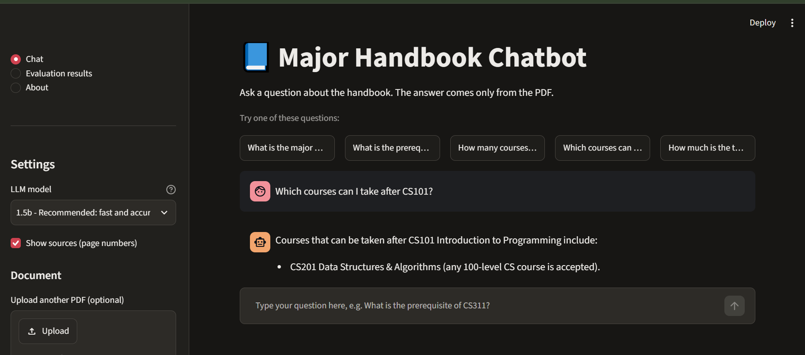

# Major Handbook RAG Chatbot (CS311 Final Project)

A local chatbot that answers questions about the **B.S. Computer Science major handbook** (PDF).
It uses Retrieval-Augmented Generation (RAG): the question is searched in the PDF, the best passages are
sent to a local language model (Ollama), and the answer is shown in a Streamlit web page with page numbers.
Everything runs on your own computer. No data is sent to the internet when answering.

## Features
- **PDF support (Task 1):** `source_code/run_pdf.py` is the simple baseline (PDF → chunks → embeddings → Chroma).
- **Handbook chatbot (Task 2):** `source_code/rag_v2.py` is the improved system (see "How it works").
- **Evaluation:** 25 test questions, 14 experiment runs, labels: correct / incomplete / ambiguous / incorrect.
- **Web interface (Task 4):** `source_code/app.py` (Streamlit): chat, chat history, sources with page numbers, model choice.
- **Docker (Task 3):** `docker/` (Dockerfile, docker-compose, instructions).

## Repository structure
```
source_code/
  app.py                  Streamlit web interface
  rag_v2.py               improved RAG system (used by the web interface)
  run_pdf.py              baseline PDF version (Task 1)
  run_txt.py              original sample code (txt files)
  evaluate.py             runs the 25 test questions and saves a CSV
  compare.py              builds the comparison table from the labeled CSV files
  flowchart_page10.txt    hand-written text of the flowchart image (page 10)
  manual_page*.txt        hand-written text of tables that the PDF reader mixes up (pages 11-12)
  major_handbook_pdfs/    the handbook PDF
  results_*.csv           results of each experiment (with labels)
docker/
  Dockerfile, docker-compose.yml, requirements-docker.txt, Dockerfile.dockerignore, DOCKER.md
report/                   final report (PDF)
demo_video/               demo videos
images/                   images for use in README.md
```

## How it works
1. **Read the PDF** with `pypdf`, fix broken characters, cut the text by section and by course.
2. **Tables and images:** the course catalogue table is turned into one sentence per course. The flowchart (an image)
   and two tables that `pypdf` reads in the wrong order are written by hand (`flowchart_page10.txt`, `manual_page*.txt`).
   "Which courses can I take after X?" notes are built from the prerequisites.
3. **Index:** chunks are embedded with `nomic-embed-text` (Ollama) and stored in ChromaDB.
4. **Search:** vector search + keyword search (BM25) are combined (Reciprocal Rank Fusion), then re-ranked with the
   cross-encoder `cross-encoder/ms-marco-MiniLM-L-6-v2`.
5. **Answer:** the top 6 passages and the question go to the LLM (default `qwen2.5:1.5b`) with a prompt that
   says "use only the context, otherwise say I don't know".

## Requirements
- Windows, macOS or Linux, Python 3.11
- [Ollama](https://ollama.com/download) with these models:
  ```
  ollama pull qwen2.5:1.5b
  ollama pull nomic-embed-text
  ollama pull qwen2.5:3b        # optional: more accurate, slower
  ```
- Python packages (see `docker/requirements-docker.txt`):
  ```
  pip install streamlit pypdf langchain-core langchain-text-splitters langchain-chroma langchain-ollama chromadb rank-bm25 sentence-transformers
  ```
- The first run needs internet once to download the re-ranker model (about 90 MB).

## Run on your computer
```
cd source_code

# Ask one question in the terminal
python rag_v2.py -q "What is the prerequisite of CS311?"

# Web interface (opens http://localhost:8501)
streamlit run app.py
```
Useful options: `--rebuild` (build the index again), `--dump` (write all chunks to `chunks_dump.txt`).
The settings are environment variables, for example (PowerShell):
```
$env:LLM_MODEL="qwen2.5:3b"; $env:PROMPT="balanced"; streamlit run app.py
```

## Run with Docker
Needs Docker Desktop and Ollama running on your computer. From the project root:
```
docker compose -f docker/docker-compose.yml up --build
```
Open http://localhost:8501. More details (Ollama inside Docker, volumes, problems): `docker/DOCKER.md`.

## Example questions
| Question | Answer |
|---|---|
| What is the major code of the B.S. Computer Science program? | 7480101 |
| What is the prerequisite of CS311 Advanced Deep Learning? | CS313 |
| How many courses are in the CS minor according to the flowchart? | 7 courses |
| Which courses can I take after CS101? | CS201 (and CS204) |
| How much is the tuition fee? | I don't know based on the handbook. |

## Evaluation
25 questions, each answer labeled by hand. Accuracy = correct / 25.

| Run | System | LLM | Accuracy |
|---|---|---|---|
| A | baseline (`run_pdf.py`) | 0.5b | 36% |
| B | baseline | 1.5b | 64% |
| C | v2 pipeline | 0.5b | 32% |
| D | v2 pipeline | 1.5b | 80% |
| E | v2 pipeline | 3b | 84% |
| F | v2 + balanced prompt | 1.5b | 92% |
| G | v2 + balanced prompt | 3b | 96% |
| M | F + hand-written tables (pages 11-12) | 1.5b | 88% |
| N | M + prerequisite look-up notes (**final**) | 1.5b | 88% |

Runs H-L switch off one part of F (rerank, BM25, table sentences, flowchart, section structure):
84-92%. Run G was made before the tables of pages 11-12 were added. The differences between runs
are only 1-3 questions, so they show a trend and not a proof. Full tables: `source_code/comparison.csv`,
details and discussion in the report.

To repeat the evaluation:
```
cd source_code
$env:LLM_MODEL="qwen2.5:1.5b"; $env:PROMPT="balanced"
python evaluate.py results_new.csv      # then fill the label column by hand
python compare.py                       # builds comparison.csv
```

## Limitations
- Small models sometimes copy a wrong number or leave out an item (for example "how many advanced courses").
- Each question is answered alone. The chat history is only shown on the page, it is not sent to the model.
- The flowchart image (page 10) and two tables (pages 11-12) were written by hand, not read automatically.
- The handbook itself says "Applied Mathematics" as the degree name (page 6). The system may repeat this mistake.
- The 25 test questions were written by the author while building the system, so the results can look better than
  they would on completely new questions.

